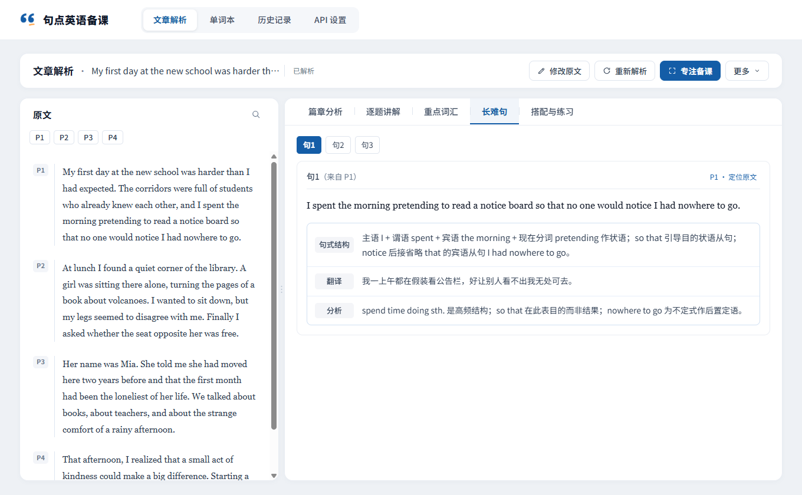

# 句点英语备课

面向英语教师的 Windows 备课工作台。从英文原文开始，整理篇章分析、试题讲解、重点词汇和长难句，在同一窗口内回到原文核对，再按教学需要生成练习或导出材料。



[在线作品集与交互演示](https://jieeee233.github.io/judian-english-prep/)

## 界面与工作流

- **文章解析**：粘贴或导入文章，切换结果板块并定位原文。
- **词汇整理**：检索词表，将重点词汇收入「我的词汇」，也可手动录入。
- **练习与导出**：勾选词条，设置题型和题数，编辑练习与答案。可导出 Word 词单或互动演示文件。
- **本地历史**：检索已有解析记录，重新打开后继续整理。

## 实现

Electron 主进程处理设置、本地文件、模型请求与导出。Vue 渲染层负责阅读、筛选与编辑，通过 preload 暴露的类型化接口调用桌面功能。打包使用 Electron Forge 和 Squirrel。

## 在本地运行

需要 Windows 和 Node.js 22.13 或更新版本。

```powershell
npm ci
npm run typecheck
npm start
```

生成 Windows 安装包可运行 `npm run make`。模型相关功能需要在应用的 API 设置中配置自己的服务地址和密钥。

## 公开展示版

本仓库使用少量原创词表示例，界面截图中的文章解析也使用内置示例。完整安装版的教材词表、课标数据、个人设置和本地历史均未收入。源目录按 `src/main`、`src/preload`、`src/renderer` 和 `src/shared` 划分。

## 许可证

项目源码采用 GPL-3.0-only，完整条款见 [LICENSE](LICENSE)。
